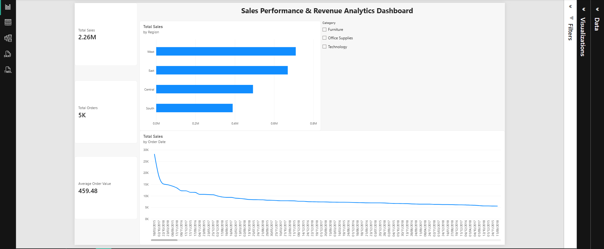

# Sales Performance & Revenue Analytics Dashboard

## 📌 Project Overview
This project focuses on analyzing sales and revenue performance for a retail store using **SQL** for data extraction/aggregation and **Power BI** for interactive data visualization.

---

## 📸 Dashboard Preview

---

## 🛠️ Tools & Technologies Used
* **SQL (SQLite / DB Browser):** Data validation, aggregation, and querying sales performance by region and products.
* **Power BI Desktop:** Data modeling, DAX measures, and dashboard visualization.
* **DAX:** Calculated measures for `Total Sales`, `Total Orders`, and `Average Order Value`.

---

## 📊 Key Insights
* **Top Region:** The **West** region achieved the highest sales (~$710K) across all regions.
* **KPIs Tracked:** Total Sales (~$2.26M), Total Orders (~5K), and Average Order Value (~$459).
* **Interactive Slicers:** Dynamic filtering by product categories (`Furniture`, `Office Supplies`, `Technology`).

---

## 📁 Repository Structure
* `Superstore_Sales_Dashboard.pbix` : Power BI Report file.
* `sales_analysis.sql` : SQL queries used for data aggregation.
* `train.csv` : Dataset source file.
* `dashboard_preview.png` : High-resolution preview of the dashboard.
